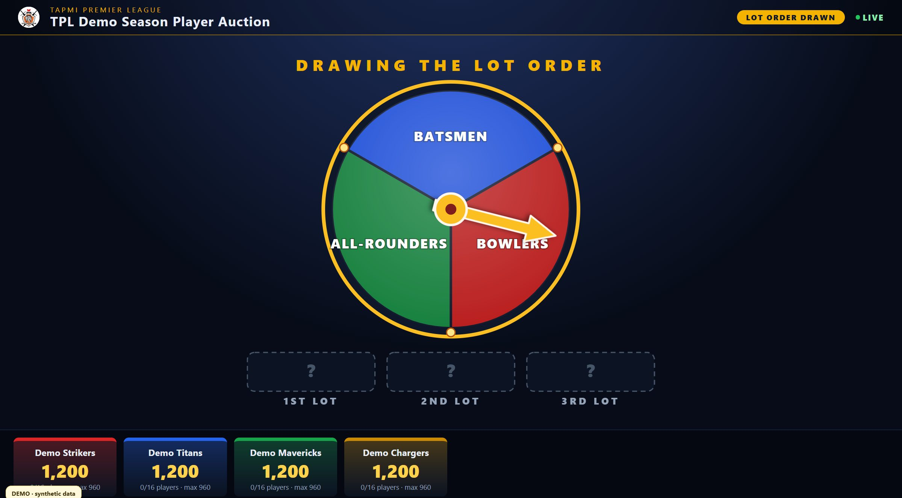
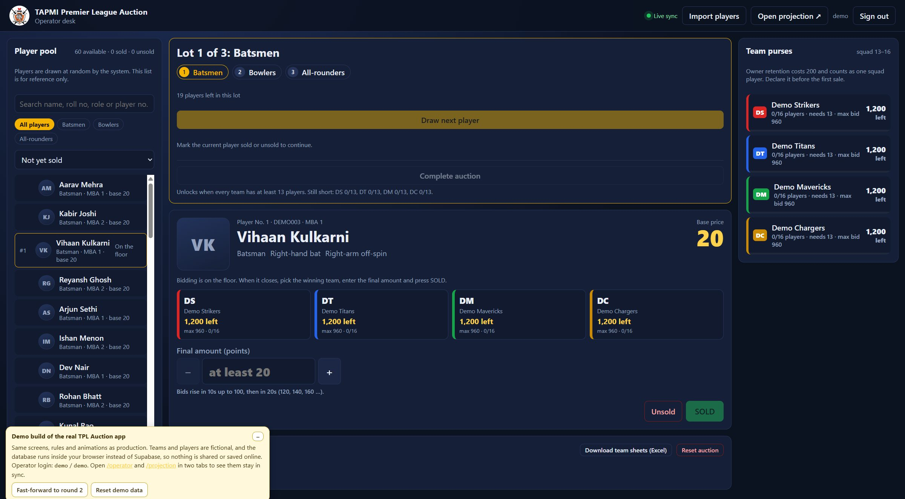
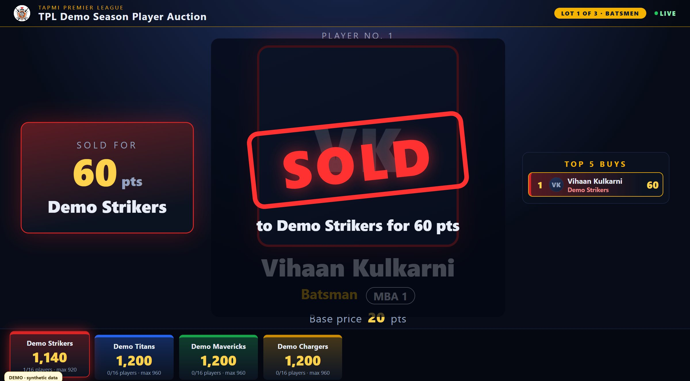
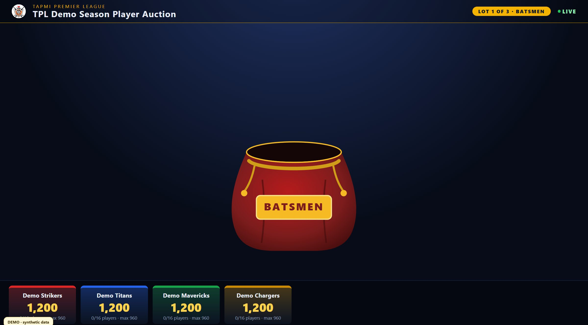
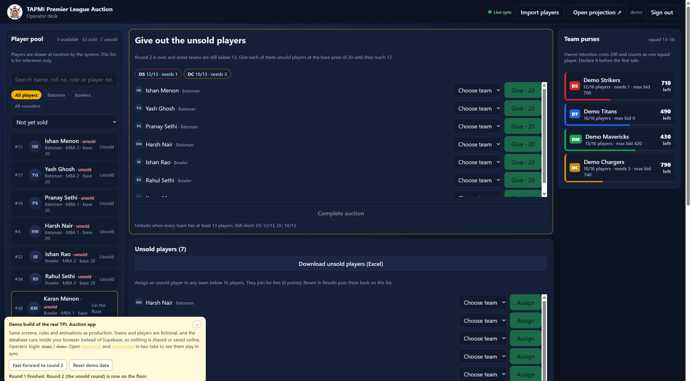
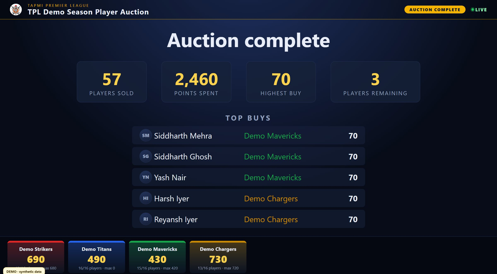

# TPL Auction Dashboard

Player-auction system for the **TAPMI Premier League (TPL)**, the cricket tournament run by The Sports Committee at T. A. Pai Management Institute. It has two screens that stay in sync in real time:

- an **operator desk** (login-protected) where the auctioneer draws players and records each sale, and
- a full-screen **projection view** for the room: lot-order wheel, player draws, SOLD/UNSOLD reveals, team purses and top buys.

**Live demo (fictional data):** https://tpl-auction-demo.vercel.app — operator login `demo` / `demo`. Open [`/operator`](https://tpl-auction-demo.vercel.app/operator) and [`/projection`](https://tpl-auction-demo.vercel.app/projection) side by side.

Portfolio and case study: https://ram-pareek-portfolio.vercel.app/#tpl

| Lot-order draw | Operator desk | SOLD reveal |
|---|---|---|
|  |  |  |
| **Random player draw** | **Giving out unsold players** | **Auction complete** |
|  |  |  |

## What it does

- **Player import.** Upload the Microsoft Forms registration export (Excel) and a photos zip. Columns are auto-detected and every row is previewed with checks before import. Contact numbers go into an operator-only table; email addresses are never read. (`src/lib/importer.ts`, `src/pages/Import.tsx`)
- **Random draws the operator can't steer.** The lot order (Batsmen, Bowlers, All-rounders) is shuffled once on the server and shown as a spinning-arrow draw; players are then drawn at random from the current lot. (`src/lib/draw.ts`, migrations)
- **Rulebook in code.** 1,200-point purses, optional playing-owner retention (200), squads of 13–16, base price 20, bidding ladder in steps of 10 up to 100 and 20 after that. (`src/lib/rules.ts`)
- **Bid and budget validation.** Bidding happens out loud; the operator enters the final price. Amounts below base price, off the ladder or above a team's maximum bid are rejected. The maximum bid keeps enough back for the team to complete its minimum squad.
- **Unsold-player workflow.** Round 2 brings back unsold players in the order they went unsold. Teams still short of 13 then receive leftover players at base price, or free if no team can afford them. Sales can be reverted.
- **Operator tools.** Step-by-step controls, player-pool filters, recent sales, team purses, team-sheet Excel and unsold-list downloads.
- **Safety.** All database writes go through operator-only `SECURITY DEFINER` SQL functions (`supabase/migrations`). The migrations record each rule change over time.
- **Tests.** 39 unit tests cover the bidding rules, draws and importer (`npm test`).

## Stack

React 18 · TypeScript · Vite · Supabase (PostgreSQL, Realtime, Storage, Auth, SQL functions) · JSZip · Vitest · Vercel

Built with AI-assisted development (Cursor, Claude). The app itself has no AI or machine-learning features.

## Demo mode

The live demo is built from this repository. `vite --mode demo` (or `TPL_DEMO=1`) swaps `src/lib/supabase.ts` for `src/demo/supabase.ts`, an in-browser stand-in that implements the same calls and reproduces the SQL functions' rules on 4 fictional teams and 60 fictional players (`src/demo/`). Every page and component is the production code. A small demo panel adds "Fast-forward to round 2" and "Reset demo data". The normal build contains no demo code.

```bash
npm ci
npm run dev:demo      # demo mode, no Supabase needed
npm test              # 39 unit tests
```

## Running against Supabase

1. Create a Supabase project and apply `supabase/migrations` (`supabase db push`).
2. Copy `.env.example` to `.env` and fill in the project URL and anon key.
3. Create the operator account with `npm run db:operator` (reads the operator credentials from `.env`).
4. `npm run dev`

## Data and privacy

This public copy contains no participant data. `supabase/seed.sql` and the test fixtures use made-up names and placeholder numbers. The production deployment, real registrations and photos are not part of this repository.
